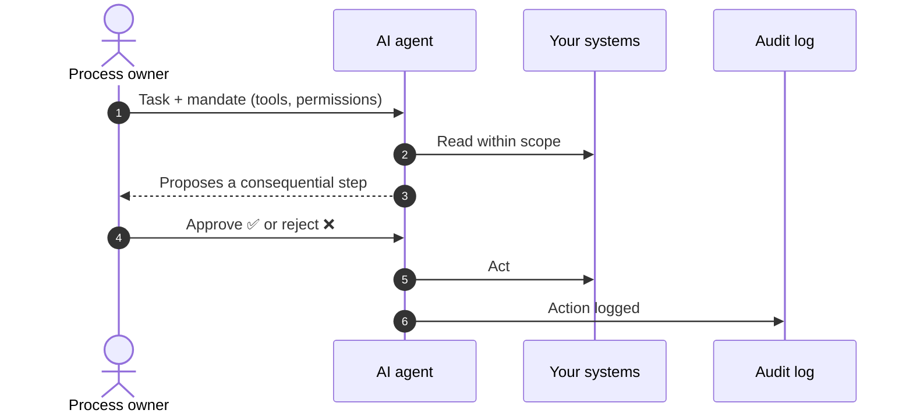
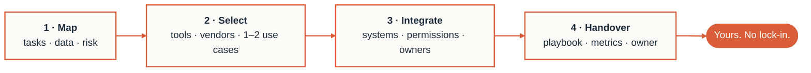

<!-- Pearls & Roses — org profile README. Lives at: Pearls-and-Roses/.github → profile/README.md -->

<div align="center">

<picture>
  <source media="(prefers-color-scheme: dark)" srcset="https://capsule-render.vercel.app/api?type=waving&height=230&section=header&color=0:1a2a3a%2C100:d95d39&text=Pearls%20%26%20Roses&fontSize=64&fontColor=fdfbf7&fontAlignY=38&desc=AI%20that%20makes%20it%20into%20daily%20work&descSize=18&descAlignY=60&animation=fadeIn">
  
</picture>

<a href="https://pearlsroses.com/en/"></a>

I help organisations put AI into the processes they already run —<br>
choose the right solution and, where needed, build it in.<br>
<sub>Copilot · agents · assistants · integrations — wired into real work, measured, handed over.</sub>

<br>

<a href="https://pearlsroses.com/en/contact/"></a>
<a href="mailto:hello@pearlsroses.com"></a>
<a href="https://pearlsroses.com/en/"></a>

<a href="#-services"><kbd> Services </kbd></a> ·
<a href="#-how-i-work"><kbd> How I work </kbd></a> ·
<a href="#-things-ive-built"><kbd> Built </kbd></a> ·
<a href="#-faq"><kbd> FAQ </kbd></a> ·
<a href="#-book-a-call"><kbd> Book a call </kbd></a>

</div>

<br>

## 🩺 Sound familiar?

Many organisations have tried AI. Fewer have it in day-to-day work.

- [ ] Copilot licences were bought, but usage is sporadic.
- [ ] People use AI tools on their own — and nobody knows what data goes in.
- [ ] Several offers on the table, no idea which one fits your process.
- [ ] The same manual work repeats every day across several systems.
- [ ] Leadership expects results from AI, but there's no owner or first use case.

**One is enough.** I start with one process and take it through to the end.
<sub>(GitHub won't let you tick these. Email will.)</sub>

> [!TIP]
> **Not sure where to start?** [Describe one process](https://pearlsroses.com/en/contact/?topic=integrations&intent=sketch) and I'll think it through with you.

## 🧱 Why pilots stall

A tool alone doesn't change the work. Four things decide whether a pilot stays a trial:

<table>
<tr>
<td width="50%" valign="top">

#### 📂 Data & permissions are messy
If nobody knows which files the tool can see, nobody trusts it. Permissions get fixed **before** a wider rollout.

</td>
<td width="50%" valign="top">

#### 🧑‍⚖️ Decision rights are undefined
No agreement on which steps a person confirms and which the system takes alone — so it stays a trial.

</td>
</tr>
<tr>
<td width="50%" valign="top">

#### 💳 A purchase isn't a change
A licence or a model changes nothing until it's tied to a real task, real data and a **named owner**.

</td>
<td width="50%" valign="top">

#### 📏 Benefit isn't measured
No before/after, no basis to decide whether to continue, expand or stop.

</td>
</tr>
</table>

## 🔐 Data & control

| Principle | In practice |
|:--|:--|
| 🇪🇺 **Data location** | Your Microsoft 365 tenant, an EU cloud, or your own server with an open model — written into the proposal. |
| 🔑 **Permissions before Copilot** | Access is reviewed first, so AI doesn't surface documents people shouldn't see. |
| 🤖 **Agents within agreed limits** | Defined tools and permissions. Consequential steps are approved by a person. Every action is logged. |
| ⚖️ **GDPR & EU AI Act** | Considered from the design stage, not bolted on afterwards. |

What "within agreed limits" looks like in practice:



## 🧩 Services

I start where you have the most manual work or uncertainty — and take it through to the end.

<table>
<tr>
<td width="50%" valign="top">

### [AI & process consulting](https://pearlsroses.com/en/ai-consulting/)
Map processes, data and risk. Leave with a clear recommendation on where to start.

`workflow & data review` `risk + EU AI Act scan` `3 use cases with ROI`

<sub>See also: [Prompt engineering](https://pearlsroses.com/en/prompt-engineering/)</sub>

</td>
<td width="50%" valign="top">

### [Integrations](https://pearlsroses.com/en/integrations/)
Connect AI, Copilot and agents to the systems you already have — the work stays where it runs.

`Microsoft 365 / CRM / ERP` `one workflow end-to-end` `before/after metrics`

<sub>See also: [Copilot rollout](https://pearlsroses.com/en/microsoft-copilot-rollout/) · [AI agents](https://pearlsroses.com/en/ai-agents/)</sub>

</td>
</tr>
<tr>
<td width="50%" valign="top">

### [Solution selection](https://pearlsroses.com/en/solution-selection/)
Define what the solution must do, write the requirements, compare offers and tools.

`requirements spec` `evaluation criteria` `recommendation with risks`

</td>
<td width="50%" valign="top">

### [Website AI readiness](https://pearlsroses.com/en/website-ai-readiness/)
Can AI search find you, and can agents actually use your site?

`GEO / AEO` `technical SEO + structured data` `MCP · A2A · llms.txt · APIs`

</td>
</tr>
</table>

> [!NOTE]
> The EU AI Act review is an initial risk assessment, not legal advice.

## 🧰 Stack

| Layer | Hands-on with |
|:--|:--|
| **Assistants** | <kbd>Microsoft 365 Copilot</kbd> <kbd>Claude</kbd> <kbd>Gemini</kbd> <kbd>Grok</kbd> <kbd>Manus</kbd> <kbd>Meta AI</kbd> |
| **Agents** | <kbd>Custom-built</kbd> <kbd>Hermes Agent</kbd> <kbd>OpenClaw</kbd> <kbd>Copilot Studio</kbd> |
| **Channels** | <kbd>Email</kbd> <kbd>Slack</kbd> <kbd>Teams</kbd> <kbd>Web</kbd> <kbd>Chat tools</kbd> |
| **Cloud AI** | <kbd>AWS</kbd> <kbd>Azure</kbd> <kbd>EU cloud</kbd> <kbd>Your own server</kbd> |
| **Models** | <kbd>Open-weight</kbd> more control, self-hostable · <kbd>Closed</kbd> ready-made, different cost & data model |
| **In production** | <kbd>Monitoring & logging</kbd> <kbd>Agent observability</kbd> <kbd>LLMOps</kbd> |

## 🔁 How I work



Permissions, guidance and owners go in **before** the circle of users grows. The solution stays with you and doesn't depend on me.

## 🚀 Things I've built

Public products, built and run by me:

<table>
<tr>
<td align="center" width="33%" valign="top">

### [Riigihanked.eu](https://riigihanked.eu/)
Search and analysis of public tenders.


</td>
<td align="center" width="33%" valign="top">

### [ted-mcp.eu](https://ted-mcp.eu/)
Open connector linking AI assistants to EU tender data.


</td>
<td align="center" width="33%" valign="top">

### [Agentic Gov](https://agenticgov.eu/)
Experiments in how an agent works within a human decision and mandate.


</td>
</tr>
</table>

## 👋 About

**Alvar Laigna** — independent AI expert and fractional CTO. 20+ years of software development, machine learning and systems integration. I assess, build and hand the work over so your people can carry on without me.

**Pearls and Roses OÜ** (est. 2019) grew out of software development, gamified solutions (games included), DevOps and fractional-CTO work. Now: AI that survives contact with Monday morning.

✍️ [alvarlaigna.com](https://alvarlaigna.com/) · [Medium](https://medium.com/@alvarlaigna) · [LinkedIn](https://www.linkedin.com/in/alvarlaigna) · [Agentic Gov](https://agenticgov.eu/)

<sub>Organisations I've crossed paths with in my work over the years: Swedbank · SEB · Nasdaq · Telia · Elisa · Tallink · ERR · University of Tartu · Starship Technologies · Rovio · Thermory · L'Oréal</sub>

<details>
<summary>📍 <b>Where</b> — Tallinn, Estonia · working in Estonian & English <sub>(interactive map)</sub></summary>

```geojson
{
  "type": "FeatureCollection",
  "features": [
    {
      "type": "Feature",
      "properties": {
        "name": "Pearls and Roses OÜ",
        "note": "Tallinn, Estonia · ET / EN",
        "marker-color": "#d95d39"
      },
      "geometry": { "type": "Point", "coordinates": [24.7536, 59.4370] }
    }
  ]
}
```

</details>

## 💬 FAQ

<details>
<summary><b>What does it cost?</b></summary>
<br>
Hourly rate €360; a lower day rate applies on longer projects. You get a precise proposal after the first conversation.
</details>

<details>
<summary><b>How long does it take?</b></summary>
<br>
A single-process solution usually takes a few weeks. More systems and more complex logic take longer. The timeline is agreed before work starts.
</details>

<details>
<summary><b>Do we need our own IT team?</b></summary>
<br>
No. You need someone who knows the process and access to the relevant systems. I handle the technical side — and I map, build and hand over myself.
</details>

<details>
<summary><b>Which systems can AI connect to?</b></summary>
<br>
Wherever your work already lives: Microsoft 365, CRM, ERP, accounting, document management, databases, public APIs, AI services on AWS and Azure, plus email, Slack, Teams, the web and chat tools. Before building, I check which integrations are needed — and safe.
</details>

<details>
<summary><b>Is Copilot worth it?</b></summary>
<br>
Not always. Before expanding licences, I test it with a small group and measure whether it saves time on your actual tasks.
</details>

<details>
<summary><b>Does our data leave the EU?</b></summary>
<br>
It doesn't have to. If EU processing is a requirement, I choose a setup that allows it and write into the proposal where data is processed.
</details>

<details>
<summary><b>I'm not technical. Is that a problem?</b></summary>
<br>
No. Your part is to describe what isn't working. I explain the options in plain language, in writing — in Estonian or English.
</details>

<details>
<summary><b>What about superintelligence?</b></summary>
<br>
AI that exceeds humans in most intellectual tasks doesn't exist yet, though progress is fast. Today's value comes from using AI well: tidy data, clear processes, accountability. Conveniently, those are also the preconditions for whatever comes next.
</details>

## 📬 Book a call

Thirty minutes on where AI would help your work — and an agreed next step.

<div align="center">

✍️ **You describe the situation** &nbsp;→&nbsp; 💬 **We talk for 30 minutes** &nbsp;→&nbsp; 📄 **You get a concrete next step, in writing**

<sub>…even if it turns out AI isn't the answer. Replies usually within a couple of working days.</sub>

<br>

<a href="https://pearlsroses.com/en/contact/"></a>
<a href="https://pearlsroses.com/en/contact/?topic=integrations&intent=sketch"></a>

</div>

<br>

<div align="center">

<picture>
  <source media="(prefers-color-scheme: dark)" srcset="https://capsule-render.vercel.app/api?type=waving&height=110&section=footer&color=0:d95d39%2C100:1a2a3a">
  
</picture>

<sub>Pearls and Roses OÜ · est. 2019 · Tallinn · <a href="https://pearlsroses.com/">ET</a> / <a href="https://pearlsroses.com/en/">EN</a> · <a href="#top">↑ top</a></sub>

<details>
<summary><sub>🌹 Off the clock</sub></summary>
<br>
<sub>Same company, different department: weird little merch for strange times, printed on demand in the EU → <a href="https://store.pearlsroses.com/">store.pearlsroses.com</a></sub>
</details>

</div>
